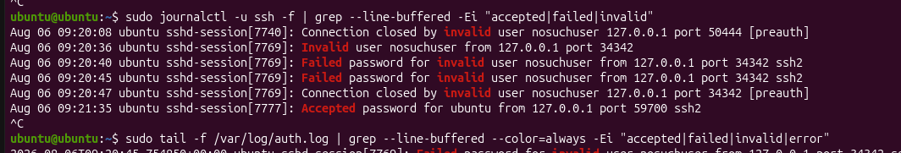
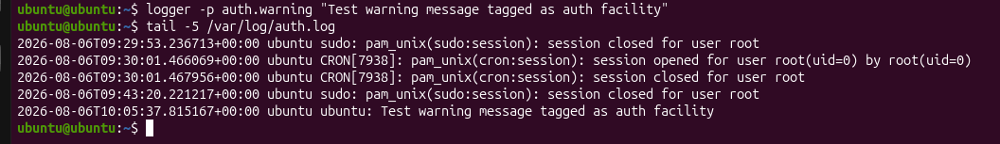

# Day 4 - Linux Logging: Syslog, Journald, Authentication Logs

> Daily activity report covering Linux authentication and system logging end to end - from raw syslog message format through rsyslog facility/severity routing to the modern systemd journal (journalctl).

---

| Field        | Detail                                                |
| ------------ | ----------------------------------------------------- |
| Date         | August 6, 2026                                        |
| Topic        | Linux Logging - Syslog, Journald, Authentication Logs |
| Environment  | Ubuntu Linux (local VM / workstation)                 |
| Topic area   | Linux logging fundamentals, authentication & system logs |

---

## Summary

Today's session focused on understanding how Linux authentication and system logging works end to end - from the raw syslog message format, through the `rsyslog` daemon and facility/severity routing, to the modern systemd journal (`journalctl`). Real SSH login events (both successful and failed) were generated and traced through both logging systems to understand exactly how and why each event is recorded, and where a security analyst would look for evidence of unauthorised access attempts.

---

## Objectives for the Session

- Understand the difference between traditional syslog logging (`rsyslog`) and the modern systemd journal (`journalctl`).
- Generate real SSH authentication events (successful and failed logins) on a test system.
- Observe how those events appear in `/var/log/auth.log` and via `journalctl`.
- Understand the syslog facility/severity system and how it routes messages to specific log files.
- Learn why authentication logs matter for security monitoring, auditing, and incident response.

---

## What I Learned

### 1. Syslog Fundamentals

Syslog is the traditional Linux logging standard, using the format:

```
<time> <hostname> <program>[<PID>]: <message>
```

Each message carries:

- **Facility** - what generated it (e.g. `auth`, `kern`, `sudo`).
- **Severity** - how important it is (e.g. `info`, `warning`, `critical`).

`rsyslog` is the daemon that receives these messages and routes them to files under `/var/log/` based on facility/severity rules defined in `/etc/rsyslog.d/50-default.conf`. For example, the `auth` facility is routed to `/var/log/auth.log` on Ubuntu (and to `/var/log/secure` on RHEL/CentOS).

### 2. systemd-journald / journalctl

`journald` is a newer logging system that stores logs in a structured, binary format (queried via `journalctl`) rather than plain text. It captures richer metadata than syslog alone:

- PID
- UID
- Boot ID
- Executable path
- Kernel / boot logs
- Service output that never touches a text file

By default, the journal may not persist across reboots unless `/var/log/journal` is created and `systemd-journald` is configured for persistent storage. This is a common pitfall on fresh Ubuntu installs.

### 3. SSH Authentication Logging

SSH login attempts are logged by the `sshd` service and routed to the `auth` facility, landing in:

- `/var/log/auth.log` (Ubuntu / Debian)
- `/var/log/secure` (RHEL / CentOS)

A successful login produces an `Accepted password` (or `Accepted publickey`) entry. A failed attempt produces a `Failed password` entry. A nonexistent account produces an `invalid user` entry.

The same event is visible in real time using either:

```bash
sudo tail -f /var/log/auth.log
sudo journalctl -u ssh -f
```

### 4. Why Authentication Logs Matter

Authentication logs are the primary evidence source for detecting brute-force attempts, unauthorised access, and credential misuse. They provide an audit trail of who accessed a system and when - a requirement for compliance frameworks (PCI-DSS, HIPAA, ISO 27001). They are also the data source that tools like `fail2ban` and SIEM platforms (e.g. Wazuh) rely on to detect and respond to attacks automatically.

Without them, there is no reliable way to answer *"who logged in, from where, and was it successful"* during an investigation.

---

## Hands-On Activities Performed

1. Verified `sshd` was installed and running:

   ```bash
   systemctl status ssh
   ```

2. Opened live log monitoring in a separate terminal using both:

   ```bash
   journalctl -u ssh -f
   tail -f /var/log/auth.log
   ```

3. Generated a successful SSH login event and confirmed it appeared correctly in both log sources.

4. Generated failed login events (wrong password, nonexistent user) and confirmed `Failed password` and `invalid user` entries appeared as expected.

5. Reviewed the rsyslog facility-routing configuration to understand why auth-related events land specifically in `auth.log`:

   ```bash
   cat /etc/rsyslog.d/50-default.conf
   ```

6. Used the `logger` command to manually inject a tagged test message and confirmed it routed to the correct log file based on its facility tag:

   ```bash
   logger -p auth.warning "Test warning message tagged as auth facility"
   tail -5 /var/log/auth.log
   ```

---

## Screenshots


*SSH service status, then started and enabled*


*journalctl output: failed password, invalid user and accepted password events (local test, 127.0.0.1)*


*logger command test: message tagged with the auth facility appearing in auth.log*

---

## Challenges / Notes

- Initial login attempts failed because the placeholder username `yourusername` was used literally instead of being replaced with the actual account name. Resolved by using `whoami` to confirm the real username and setting its password with `sudo passwd`.
- Confirmed that attempts against a genuinely nonexistent user (e.g. `nosuchuser`) are expected to always fail - this is correct behaviour, not an error. The `invalid user` marker in the log is the key signal for SOC triage: it indicates an attacker who does not know valid usernames on the host, which itself is a useful correlation indicator.

---

## Next Steps

- Configure `fail2ban` to automatically respond to repeated failed SSH login attempts using these same log sources.
- Explore centralising these logs into a SIEM (Wazuh) for alerting and long-term retention.
- Set up persistent journald storage (`/var/log/journal`) to ensure journal logs survive reboots.
- Build a Wazuh rule on the `Failed password` and `invalid user` patterns to raise an alert on brute-force thresholds (e.g. > 5 failures per source IP in 60 seconds).

---

[<- Back to Portfolio README](README.md)
